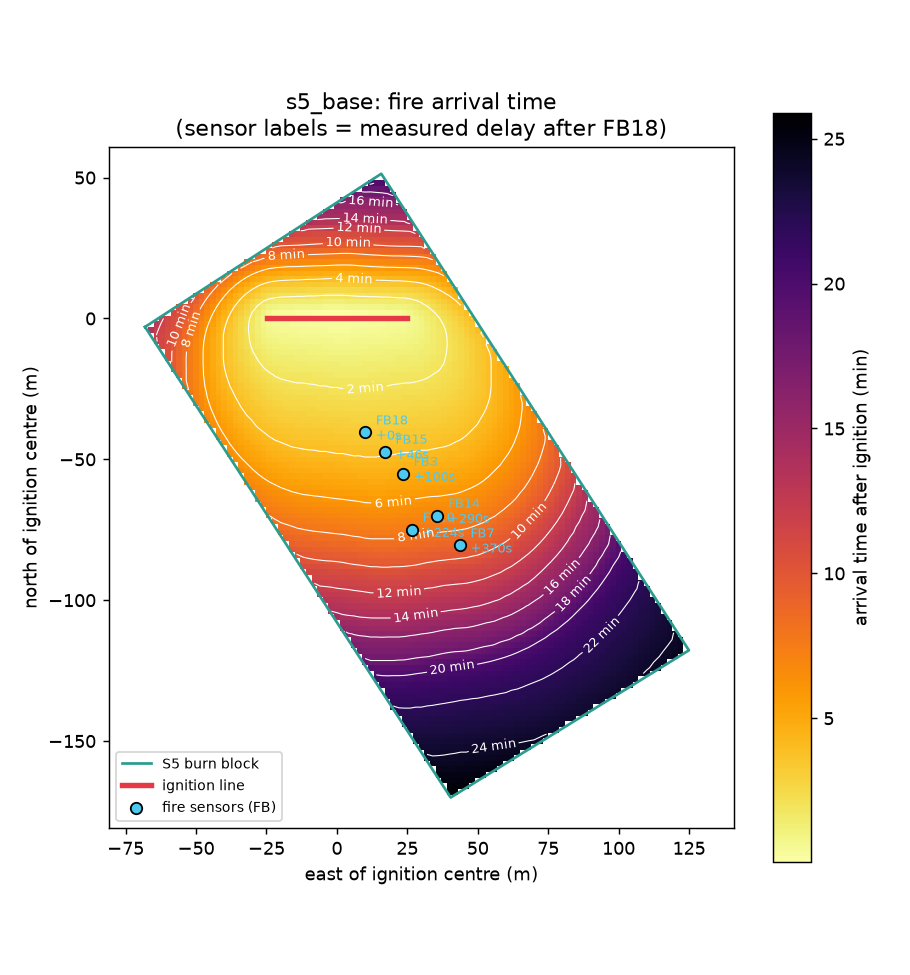
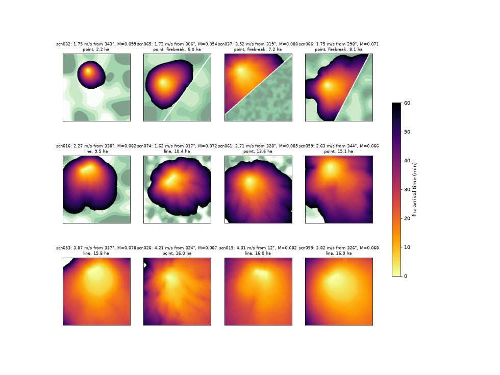
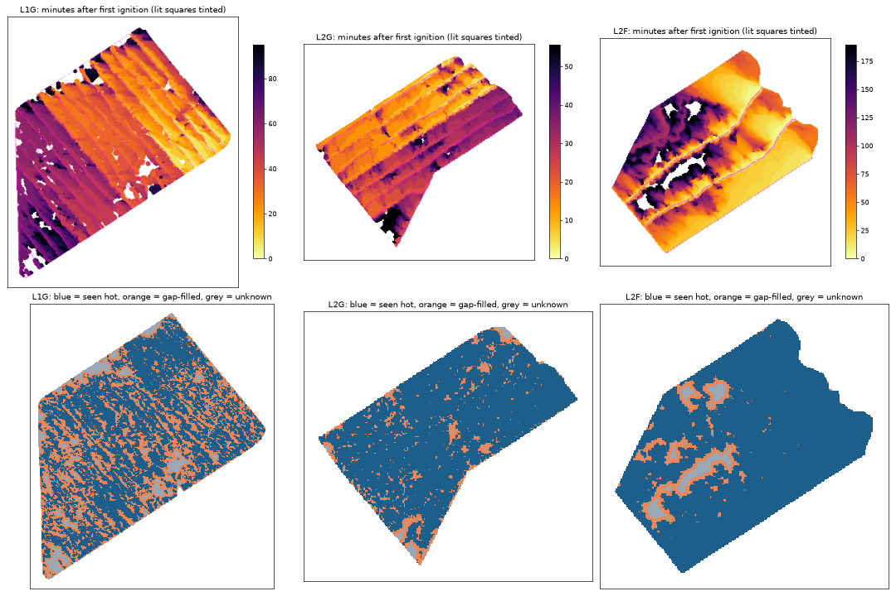

# RxCADRE Simulations

Physics-based wildfire spread scenarios for drone-based spread prediction research.
NIST's [Fire Dynamics Simulator (FDS)](https://github.com/firemodels/fds) level-set
model is calibrated against the **RxCADRE 2012 S5** prescribed grass burn (Eglin
AFB, Florida, 1 Nov 2012) and then used to generate fictitious, but physically
grounded, fire scenarios. The scenarios serve as ground truth for the sibling
project `drone_lab/wildfire_spread_prediction` (its `--fds-scenario` mode).

The project then moved on to the **CSIRO grass fires C064 and F19** (Annaburroo, Australia,
1986), which come with a full field record, and ran them in three simulators with the same
measured inputs and nothing tuned: FDS level-set mode, [ELMFIRE](https://github.com/lautenberger/elmfire)
and FDS full physics. See [CSIRO grass fires](#csiro-grass-fires-1986).



## Results

**S5 calibration.** All inputs are measured except the fuel-bed depth, the least
constrained Rothermel input, which was swept (`scripts/calibrate_s5.sh`). Every measured
value is read directly from the RxCADRE files (`python -m rxcadre_sim.s5_inputs` prints each
value with its file, row and column).

| Input | Value | Source |
|---|---|---|
| Plot | official S5 perimeter, 19,957 m² | RDS-2014-0031 |
| Fuel load | 0.282 kg/m² (dead fuel moisture 8.6 %) | RDS-2014-0028 |
| Wind | 1-minute series from the S5 anemometers (3.05 m): mean 2.8 m/s, ranging 1.3–3.8 m/s; direction mean 339°, swinging between 264° and 9° | RDS-2016-0038 |
| Ignition | surveyed 50 m line, lit from the centre outward at 1.34 m/s | RDS-2016-0014 |
| Fuel model | Rothermel-Albini #1 (short grass), depth calibrated to **0.42 m** | this work |

The wind was very variable. Three of the nine anemometers (A1, A4, A5) disagree with the
other six by 40–71° in direction, matching the RxCADRE metadata's warning about misaligned
instruments, so their speeds are used but their directions are not. The run uses the measured
1-minute series (as FDS `RAMP`s) rather than one average.

| | Measured | Steady mean wind, depth 0.37 m | 1-minute wind, depth 0.42 m |
|---|---|---|---|
| Head-fire rate of spread | 0.123 m/s | 0.120 m/s | **0.128 m/s** |
| Arrival-time RMSE at 6 sensors | — | 34 s | **32 s** |
| Implied ignition time (UTC) | ~18:07 (extrapolated from sensors) | 18:05 | **18:08** |

Using the 3 m anemometer wind directly as mid-flame wind (`VEG_LSET_WIND_HEIGHT=3.05`)
over-predicts spread 2.5–10×, so the FDS default wind adjustment is used. With the 1-minute
wind, four of the six sensors are within 12 s; the rest of the error comes from two sensors
10 m apart that the real fire reached in the reverse order (fuel or gust heterogeneity that a
uniform fuel bed and a spatially uniform wind cannot reproduce).

**100 fictitious scenarios** (`scenarios/`) on a 400 × 400 m grid of 2 m cells
(matching the drone simulation's `TerrainGrid`), sampled from the measured
RxCADRE small-plot (S3–S9) ranges:

| Parameter | Range |
|---|---|
| Wind | 1.5–4.5 m/s from 335° ± 45°, one gradual shift of up to ±40°, gusts up to ±25 % |
| Dead fuel moisture | 6.4–10 % |
| Fuel load | 0.24–0.41 kg/m² |
| Fuel depth | 0.30–0.44 m (calibrated depth scaled by each plot's grass height) |
| Fuel patchiness | spatially correlated, 0–35 % strength, 8–40 m patch size |
| Ignition | point or walked drip-torch line, upwind of centre |
| Firebreak | 6 m bare road across the wind in about a third of scenarios |

Burned area ranges from 2.2 to 16 ha (median 12 ha); 90 of 100 fires reach the domain
edge within the hour.



**Head-fire spread-rate table** (`data/derived/fds_head_ros_table.npz`): FDS's
head-fire rate of spread from 1,134 controlled runs (uniform fuel, steady wind,
planar front) over wind 0–7.5 m/s × dead moisture 6–10 % × fuel depth 0.12–0.8 m ×
fuel load 0.1–0.75 kg/m². It is the "true" spread-rate field in the drone
simulation's replay mode and the target its estimator is fitted to. It reproduces
the steady-wind S5 run to within 5 % (0.126 vs 0.120 m/s). In FDS's Rothermel
model, spread depends strongly on fuel depth (12× over the range) but barely on
load at fixed depth (±5 %).

**Real test burns** (`real_burns/L1G.npz`, `L2G.npz`, `L2F.npz`): the three large 2012 burns
in the training-data layout (8 m cells, seconds after first ignition). Arrival times come from
the airborne heat camera (first pass above 1,000 W/m²); ignition times from the drip-torch ATV
GPS tracks; fuel, moisture and wind are the measured block averages. Grass fronts often cross
a pixel between two passes, so gaps within 24 m of a detection are filled and flagged
(`arrival_observed`). Recorded lighting explains all but 0–2% of each burn.

| Burn | Grid | Seen hot | Gap-filled | Unknown | Passes | Mean wind |
|---|---|---|---|---|---|---|
| L1G (grass) | 414 × 353 | 60% | 35% | 5% | 28 over 95 min | 3.5 m/s |
| L2G (grass) | 229 × 245 | 88% | 11% | 1% | 20 over 56 min | 2.3 m/s |
| L2F (pine forest) | 233 × 236 | 88% | 8% | 3% | 51 over 189 min | 1.9 m/s |



## Installation

Requires macOS or Linux, Python 3.12+, and FDS 6.11 (installed from the
[FDS releases](https://github.com/firemodels/fds/releases); on Apple Silicon the
x86 build runs under Rosetta). The scripts expect FDS's environment at
`~/FDS/FDS6/bin/fds_env.zsh`.

```bash
python3 -m venv .venv
.venv/bin/pip install -r requirements-dev.txt
```

## Running the pipeline

```bash
# 1. Download the public RxCADRE datasets (~400 MB, S5 slices only)
.venv/bin/python -m rxcadre_sim.download

# 2. Derive S5 perimeter, sensor arrivals, wind and measured spread rate
.venv/bin/python -m rxcadre_sim.prepare_s5

# 3. Build, run and score the calibrated S5 base case (~15 s)
.venv/bin/python -m rxcadre_sim.s5_case --chid s5_base
scripts/run_fds_batch.sh runs
.venv/bin/python -m rxcadre_sim.s5_compare runs/s5_base --detail
.venv/bin/python -m rxcadre_sim.s5_map runs/s5_base

# Optional: reproduce the calibration sweep
scripts/calibrate_s5.sh

# 4. Generate and run the fictitious scenarios (~30 min for 100 on 14 cores)
.venv/bin/python -m rxcadre_sim.scenarios --count 100
scripts/run_fds_batch.sh scenarios 14

# 5. Tabulate FDS head-fire spread rates (1,134 runs, ~3 min)
.venv/bin/python -m rxcadre_sim.ros_table write
scripts/run_fds_batch.sh ros_table 14
.venv/bin/python -m rxcadre_sim.ros_table collect --out data/derived/fds_head_ros_table.npz

# 6. Build the real test burns (L1G, L2G, L2F)
.venv/bin/python -m rxcadre_sim.real_burns

# 7. Export ground-truth grids for the drone simulation, and plot an overview
.venv/bin/python -m rxcadre_sim.scenario_export scenarios/scn* \
    --out-dir ../drone_lab/wildfire_spread_prediction/data/fds_scenarios
.venv/bin/python -m rxcadre_sim.scenario_overview ../drone_lab/wildfire_spread_prediction/data/fds_scenarios
```

Each exported `scnNNN.npz` holds fire arrival time, spread velocity, fuel load,
fuel depth and moisture per cell, plus the wind time series and the scenario spec.

## CSIRO grass fires (1986)

Each plot has 16 measured grass samples (load, height, grass type), the 2 m wind at its four
corners every 5 s, a site weather station and the lighting crews' pace. One Python module per
simulator translates these into that simulator's input files:

| Module | Simulator | What it does |
|---|---|---|
| `annaburroo.py` | (data) | downloads CSIRO's dataset; reads the corner wind and the typed-in fuel samples (`data/derived/csiro_fuel_samples.csv`) |
| `csiro.py` | FDS level-set mode 4 | downloads NIST's validation inputs and measured head positions; compares runs with them |
| `csiro_fds_fast.py` | FDS level-set mode 1 | rewrites NIST's inputs for mode 1 on a 1 m grid with the field grass, wind and lighting |
| `elmfire_csiro.py` | ELMFIRE 1.1 | writes ELMFIRE's GeoTIFF maps and `elmfire.data` for each case, runs it, reads arrival times |
| `csiro_fds_full.py` | FDS full physics | keeps NIST's full-physics grid and physics, swaps in the 16-patch grass, field wind and lighting |

Fire-head speed against CSIRO's burn table (real: C064 1.18 m/s, F19 1.85 m/s), measured
inputs, nothing tuned:

| | C064 | F19 |
|---|---|---|
| ELMFIRE | 24 % | 44 % |
| FDS full physics | 88 % | 81 % |

ELMFIRE must be built in `~/elmfire` (or set `ELMFIRE_DIR`), with GDAL's command-line tools on
`PATH` or in the micromamba env `~/micromamba/envs/elmfire` (or set `GDAL_BIN_DIR`).

```bash
.venv/bin/python -m rxcadre_sim.annaburroo download      # CSIRO field data (584 MB)
.venv/bin/python -m rxcadre_sim.csiro download           # NIST level-set inputs + measurements
.venv/bin/python -m rxcadre_sim.csiro_fds_full download  # NIST full-physics inputs + results

# FDS level-set mode 4 (NIST's files as they are)
.venv/bin/python -m rxcadre_sim.csiro setup
scripts/run_fds_batch.sh runs/csiro
.venv/bin/python -m rxcadre_sim.csiro compare

# ELMFIRE (seconds per case)
.venv/bin/python -m rxcadre_sim.elmfire_csiro setup
.venv/bin/python -m rxcadre_sim.elmfire_csiro run
.venv/bin/python -m rxcadre_sim.elmfire_csiro compare

# FDS level-set mode 1 (about 50 s per case)
.venv/bin/python -m rxcadre_sim.csiro_fds_fast setup
scripts/run_fds_batch.sh runs/csiro_fast 4
.venv/bin/python -m rxcadre_sim.csiro_fds_fast compare

# FDS full physics (4 to 70 min per case on 12 cores; F19 runs on the 1 m grid only)
.venv/bin/python -m rxcadre_sim.csiro_fds_full setup
.venv/bin/python -m rxcadre_sim.csiro_fds_full run
.venv/bin/python -m rxcadre_sim.csiro_fds_full compare
```

## Testing

```bash
.venv/bin/python -m pytest
.venv/bin/ruff check .
```

## Project layout

```
rxcadre_sim/   download, S5 data prep, S5 case/compare/map, scenario generation/export/overview,
               CSIRO translators for FDS and ELMFIRE
scripts/       FDS batch runner and calibration sweep
data/derived/  small S5 inputs and validation targets (tracked); data/raw/ is downloaded
runs/          S5 base and calibration cases (inputs tracked, FDS outputs ignored);
               CSIRO cases are written by each module's setup command
scenarios/     100 scenario inputs + specs (FDS outputs ignored)
docs/          figures
```

## Limitations

- **Level-set mode 1:** the fire front follows Rothermel-Albini spread with uniform,
  prescribed wind. No fire-induced winds, no spotting, flat terrain.
- **Calibrated on one burn:** only head-fire arrival was measured, so flank and
  backing spread (fire shape) are not validated. The RxCADRE airborne infrared
  data (RDS-2017-0027) could check this.
- **Moisture capped at 10 %:** fuel model 1 has a 12 % dead-fuel moisture of
  extinction. Plot S7 (13 % litter moisture) burned in reality, but would not in
  this model.
- **FDS arrival-time devices:** `FIRE ARRIVAL TIME` devices that are only written at the
  end of a run report meaningless times; written every 10 s (as in the S5 case) they
  agree with the level-set slice to within ~10 s. The table tracks the front from the slice.
- **Fires reach the edge:** most scenarios reach the 400 m domain edge within
  20–40 min, which limits long forecast horizons.

## Data sources

All RxCADRE data are public, from the USDA Forest Service Research Data Archive:

- Ottmar, R.D.; Restaino, J.C. 2014. *RxCADRE 2008, 2011, and 2012: Ground fuel measurements from prescribed fires.* https://doi.org/10.2737/RDS-2014-0028
- Jimenez, D.M.; Butler, B.W. 2016. *RxCADRE 2012: In-situ fire behavior measurements.* https://doi.org/10.2737/RDS-2016-0038
- *RxCADRE 2012: Instrument and infrared target survey locations and attributes.* https://doi.org/10.2737/RDS-2016-0014
- *RxCADRE 2008, 2011, and 2012: Burn blocks.* https://doi.org/10.2737/RDS-2014-0031
CSIRO data and the papers the inputs come from:

- Gould, J.S.; Cruz, M.G.; Sullivan, A.L. 2024. *1986 Annaburroo Experimental Grassland Fire Data.* CSIRO, CC BY 4.0. https://doi.org/10.25919/ycd3-w209
- Gould, J.S.; Cruz, M.G.; Sullivan, A.L. 2024. *The 1986 Annaburroo experimental grassland fires: data.* International Journal of Wildland Fire 33, WF23100. https://doi.org/10.1071/WF23100
- Mell, W.; Jenkins, M.A.; Gould, J.; Cheney, P. 2007. *A physics-based approach to modelling grassland fires.* International Journal of Wildland Fire 16, 1–22. https://doi.org/10.1071/WF06002
- NIST FDS 6.11.1 validation case *CSIRO Grassland Fires*: https://github.com/firemodels/fds/tree/FDS-6.11.1/Validation/CSIRO_Grassland_Fires
- Lautenberger, C. 2013. *Wildland fire modeling with an Eulerian level set method and automated calibration.* Fire Safety Journal 62, 289–298. https://doi.org/10.1016/j.firesaf.2013.08.014

RxCADRE background:

- Background: *Modeling Low Intensity Fires: Lessons Learned from 2012 RxCADRE.* Atmosphere 12(2):139, 2021. https://doi.org/10.3390/atmos12020139
